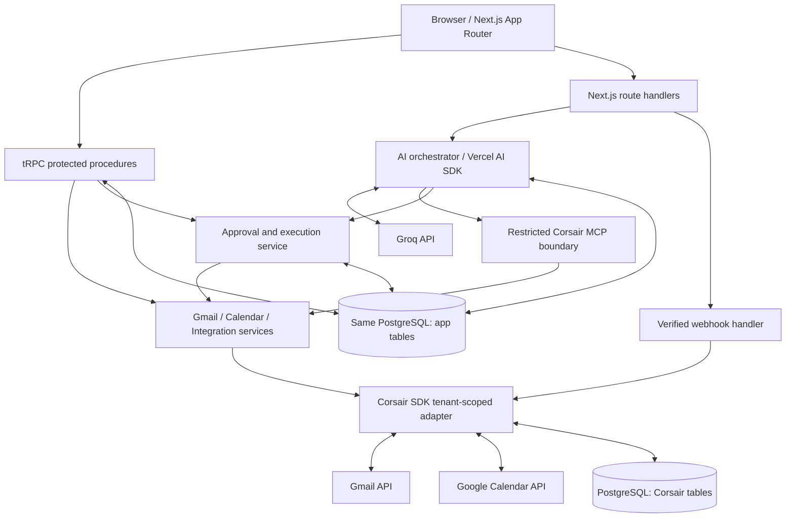
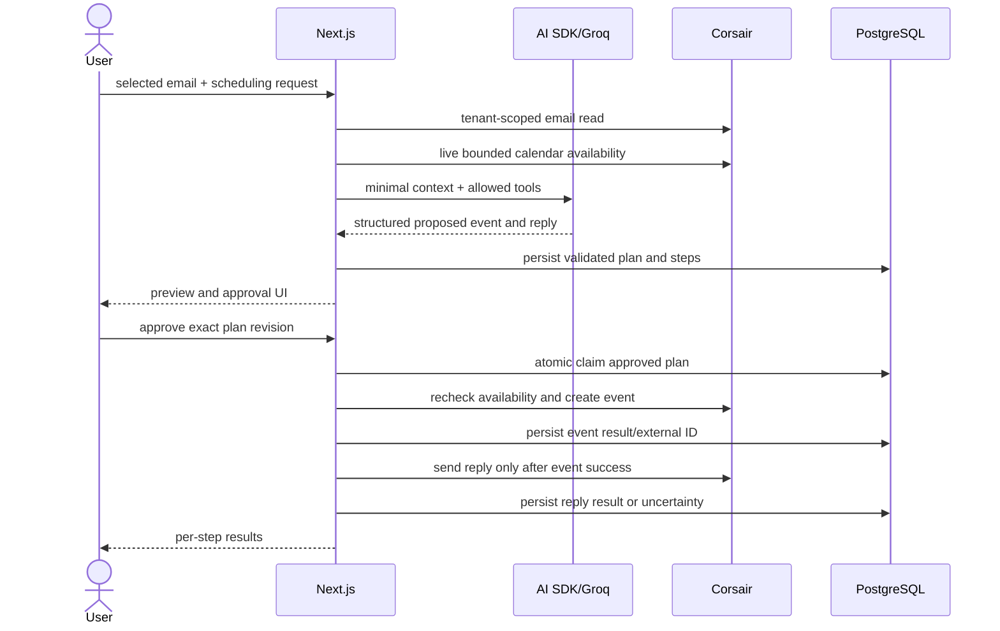

# System architecture (HLD + LLD)

## High-level design
A modular monolith: one Next.js app, one Postgres database. The browser never receives database credentials, OAuth tokens, Corsair KEK or Groq key.

The model proposes plans; approval and execution service is the only AI-originated write boundary. The arrow from AI to approval service is proposal creation, not approval. Manual UI mutations are separately authorized and explicit. MCP server/transport compatibility is a blocking design spike (see AI_AGENT); do not introduce Express to copy an upstream example.

## Module design
| Module | Owns | Depends on |
|---|---|---|
| identity/workspace | session, workspace resolution | app repositories |
| integrations | connection status, OAuth flow, disconnect, mapping | identity, Corsair |
| gmail | list/search/read/draft/send/reply | integration context, Corsair adapter |
| calendar | list/get/create/update/delete, availability | integration context, Corsair adapter |
| assistant | chat, context, read tools, plan generation | identity, services, Groq via AI SDK |
| actions | plan/step validation, approval, execution, reconciliation | identity, gmail/calendar services |
| sync | verified webhook processing, manual refresh, freshness | integration context, Corsair |
| activity | sanitized audit views | actions, sync repositories |

Dependency direction: route/UI → procedure/handler → service → adapter/repository → DB or Corsair. Services can share typed interfaces, not UI or other router internals. tRPC context authenticates and derives workspace and tenant; scope every query and tool. Use a transaction for app state transitions, never hold a transaction open across Google or Groq network calls.

## Data path
- Cached list/search for fast UI; display `lastSyncedAt`; live read on cache miss or user refresh. Inspect how installed Corsair populates individual messages: listing thread IDs alone does not prove message bodies were cached.
- Live writes through Corsair, then invalidate relevant client query and reconcile/refetch cache. Google is authoritative for external email/events; app owns approvals and chat state.
- Availability must use fresh bounded Calendar data and chosen calendars. UTC timestamps internally with IANA timezone for display; preserve date-only all-day semantics. Check again immediately before creating an event; concurrent Google changes can still occur.
- Do not duplicate Corsair email/event tables; add app metadata only if required.

## Main workflow sequence

## Failure handling
Read retries with bounded backoff; obey provider quotas. External write timeout may mean success: mark unknown, reconcile with provider identifiers before retry. No automatic replay of ambiguous sends. See DATABASE and AI_AGENT. No queue or worker required for short manual demo; if hosting cannot finish a request reliably, block release or agree on a different deployment strategy, not a new service by default.

## Extending the system
Add plugin registration, capability-specific adapter, UI route, permissions, tests and optional metadata. No empty abstractions for future providers until needed. Drive/Docs/Excel are out of scope. No direct Google API bypass.
