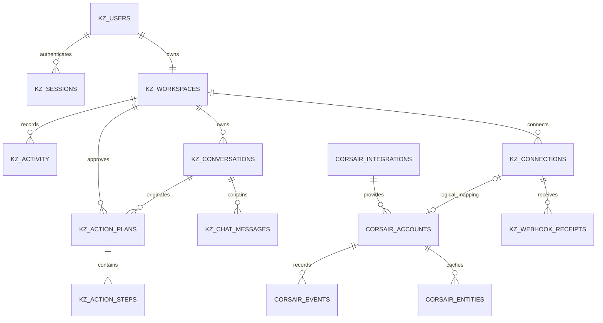

# Database design — PostgreSQL + Drizzle

## Ownership and modeling assumptions
One database. Preserve the official starter's Corsair table definitions/migration ownership; app tables use `kz_` prefix. Reconcile against installed Corsair version before migration. This is a design, not an executable migration. Personal workspace, one account per provider, opaque Google/Corsair IDs stored as text. App identifiers are UUID; timestamps are timestamptz except explicitly date-only event fields (held by provider). Use JSONB only for flexible validated payloads, not ownership or statuses.

## Runtime connection foundation (P02.2)

The application uses Drizzle ORM with its `node-postgres` driver and a `pg.Pool`. The pool and Drizzle client are created lazily by `src/server/db/index.ts` on first `getDb()` call, cached on `globalThis` during Next.js development reloads, and marked server-only. Pool defaults are 10 clients, a 5-second connection timeout, and a 30-second idle timeout. Importing the module alone does not validate the URL, create a pool, or connect.

`DATABASE_URL` is validated by the shared Zod environment schema only when `getDb()` is called or Drizzle Kit loads its config. Errors name the variable and safe requirement, never echo its value. Next.js loads `.env.local` in app runtime; `drizzle.config.ts` uses the version-matched `@next/env` loader when Drizzle Kit runs outside Next.js. Production builds and routes that do not call `getDb()` need no database connection.

The Corsair Google Demo package reviewed for P02.2 uses `drizzle-orm@^0.41.0` with the `postgres` (postgres.js) driver, not `pg`. This is a driver choice in that demo, not a PostgreSQL or Drizzle requirement. The current public Corsair source inspected for P02.3 accepts a `pg.Pool` and wraps it with Kysely's PostgreSQL dialect; this does not verify the behavior of a future pinned Corsair package. Resolve Corsair installation, exact-version compatibility, schema setup, and migration ownership before initializing it in P03.

P02.3 defines only the KriyZen-owned `kz_*` tables below. The Drizzle schema entry point exports no Corsair tables. `drizzle.config.ts` points only to this KriyZen schema and sets `tablesFilter: ["kz_*"]`. These config filters are an additional guard, not proof that generated SQL is safe; inspect every migration before applying it. Drizzle migration history uses the application-owned `kriyzen_migrations.__drizzle_migrations` table, separate from application objects in `public` and any Corsair migration namespace. This gives each owner independent history; it does not itself guarantee that future Corsair migrations won't alter KriyZen objects, so inspect their version-specific setup before P03.

P02.4 generated and applied `drizzle/0000_equal_beast.sql`. The migration creates six `kz_*` PostgreSQL enums and the eight documented `kz_*` tables in `public`; its history row is stored in `kriyzen_migrations.__drizzle_migrations`. Catalog review confirmed the objects and constraints after application. Subsequent migrations still require SQL review before apply; do not use `drizzle-kit push`.

P02.5's `pnpm test:db` integration suite connects through the lazy Drizzle client and checks representative inserts and integrity constraints against PostgreSQL. It uses synthetic rows in rolled-back transactions and makes no schema changes. Verified SQLSTATEs include `23502`, `23503`, `23505`, `22P02`, and `23514`. These database constraints enforce relational integrity, but do not replace server authorization: derive workspace/tenant from a verified session, validate Corsair account ownership, and enforce current approval/hash/expiry and action-step lifecycle rules in server code.

P02.6 applied the committed migration to a uniquely named, empty local verification database and compared normalized enum labels, table columns/defaults, constraints, and indexes against `kriyzen`. Both contained eight application tables, six enums, 33 constraints, 23 indexes, and one application-owned migration-history row, with no Corsair tables. The temporary database was removed; the existing `kriyzen` database and schema were not reset or changed.

## Entity relationship diagram

Logical mapping is not an imposed FK across ownership boundaries. Validate tenant + integration + account on every use. Session table is conditional on selected auth mechanism; do not create duplicate library-owned auth storage.

## Corsair-owned tables (starter observed schema, abbreviated)
| Table | Key columns | Purpose |
|---|---|---|
| corsair_integrations | id, name, config, dek, created_at, updated_at | integration configuration |
| corsair_accounts | id, tenant_id, integration_id, config, dek, created_at, updated_at | tenant connection state |
| corsair_entities | id, account_id, entity_id, entity_type, version, data, created_at, updated_at | cached provider entities |
| corsair_events | id, account_id, event_type, payload, status, created_at, updated_at | integration events |
Do not write encrypted configs or cache rows directly, duplicate provider tokens, or alter Corsair constraints without upstream compatibility review. Cache deduplication may be required by entity ID and newest updated timestamp; IDs are scoped by account and entity type.

This inventory reflects the previously reviewed four-table Corsair schema. The current public Corsair source also includes `corsair_permissions`; the vendor table inventory is version-dependent. KriyZen does not define or modify any of these vendor tables. Pin and inspect the SDK version, supported pool/ORM adapter, setup behavior, and migration ownership in P03 before initializing Corsair.

## KriyZen-owned tables (implemented schema, P02.3)
Notation: `!` required; otherwise nullable. Every id PK UUID, every created_at ! defaults now; updated_at ! where mutable, maintained by application/ORM. All status values constrained via enum/check. Tables below are logical columns; auth library choice can change only identity/session implementation via ADR.

| Table | Columns and constraints |
|---|---|
| kz_users | id, google_sub text ! unique (stable OIDC subject, not email), email text !, display_name text, avatar_url text, timezone text ! default Asia/Kolkata (user-editable), created_at, updated_at |
| kz_workspaces | id, owner_user_id UUID ! FK users unique, corsair_tenant_id text ! unique (server-generated), name text !, created_at, updated_at |
| kz_sessions (conditional) | id, user_id UUID ! FK users, token_hash text ! unique, expires_at timestamptz !, revoked_at timestamptz, created_at; replace with approved library/session design if applicable |
| kz_connections | id, workspace_id UUID ! FK workspaces, provider enum ! (`gmail`, `googlecalendar`), corsair_account_id text unique nullable until verified, account_label text, status enum !, last_synced_at timestamptz, last_error_code text, created_at, updated_at; unique(workspace_id,provider) |
| kz_conversations | id, workspace_id UUID ! FK workspaces, title text !, created_at, updated_at |
| kz_chat_messages | id, workspace_id UUID !, conversation_id UUID !, role enum ! (user/assistant/tool), parts JSONB ! (validated, bounded), created_at; composite FK to conversation workspace/id |
| kz_action_plans | id, workspace_id UUID !, conversation_id UUID !, revision int ! default 1, status enum !, payload_hash text !, expires_at timestamptz !, approved_by UUID FK users, approved_at timestamptz, created_at, updated_at; composite FK conversation; approver must be workspace owner |
| kz_action_steps | id, workspace_id UUID !, plan_id UUID !, ordinal int !, kind text !, input JSONB !, status enum !, idempotency_key text !, provider_reference text, error_code text, attempt_count int ! default 0, started_at timestamptz, finished_at timestamptz, created_at, updated_at; unique(plan_id,ordinal), unique(workspace_id,idempotency_key), composite FK plan |
| kz_activity | id, workspace_id UUID ! FK workspaces, actor_type text !, operation text !, status enum ! (`succeeded`, `failed`, `unknown`), reference_id text, safe_summary text, created_at |
| kz_webhook_receipts (P1, only if Corsair does not already deduplicate sufficiently) | id, workspace_id UUID !, connection_id UUID !, delivery_key text !, status text !, attempts int ! default 0, created_at, updated_at; unique(connection_id,delivery_key); composite FK connection |

Every composite parent referenced above has unique(workspace_id,id). Non-composite child workspace FK implied for all workspace-owned rows. Validate approved_by is owner server-side, or enforce additional composite relationship. Plan/step input cannot mutate after approval: edit creates a new revision with new hash (same plan may be updated only while proposed; old approval rejected). Hash covers ordered steps, validated inputs, workspace and revision; canonical server serialization. Use explicit version checks in transactions. Cascade dependent app data only through deliberate workspace/account deletion procedures; never cascade into Corsair by guesswork.

The schema enforces the workspace and parent-row relationships, single owner per user/workspace, and plan approver equals workspace owner. Server authorization must still derive the active workspace and Corsair tenant from the verified session for every read and write; never trust client/model-supplied IDs. Before using `corsair_account_id`, server code must verify the referenced Corsair account belongs to that workspace's tenant and expected integration. The database cannot verify that vendor ownership because it intentionally has no cross-vendor FK.

Database uniqueness on `(workspace_id, idempotency_key)` prevents duplicate step keys within a workspace, but does not make a remote provider write exactly-once. The server must atomically claim the current plan revision/hash, persist step state before and after remote calls, and reconcile `unknown` outcomes before retry. It must reject stale approvals, changed payload hashes, expired plans, and replay of succeeded steps.

## State machines
Connection: disconnected → connecting → connected; errors → needs_reauth/error; disconnect invalidates tools immediately. Plan: proposed → approved → executing → succeeded/partial_failed/failed/needs_reconciliation; proposed → cancelled/expired. Steps: pending → running → succeeded/failed/unknown; downstream → skipped if dependency fails. Reconcile unknown before any replay. A partial plan may resume only independently verified safe failed steps after explicit retry approval; never replay succeeded steps.

Activity records are append-only outcomes, not an execution state machine. `succeeded` means the recorded operation definitely succeeded, `failed` means it definitely failed, and `unknown` means the external outcome is uncertain and needs reconciliation. Store the operation separately (for example, `plan_approved` with status `succeeded`). Do not store a running activity status; active work is represented by action-plan and action-step states.

## Indexes
- users(google_sub), workspaces(owner_user_id), workspaces(corsair_tenant_id) unique.
- connections(workspace_id,provider) unique; activity(workspace_id,created_at DESC).
- conversations(workspace_id,updated_at DESC); messages(conversation_id,created_at,id).
- plans(workspace_id,status,expires_at); steps(plan_id,ordinal) unique; idempotency uniqueness above.
- Index all frequently joined foreign keys not covered by existing indexes. Inspect Corsair cache query plans before proposing indexes; do not modify vendor tables casually.

The application schema sets restrictive foreign-key deletion behavior rather than cascading dependent rows. Workspace/account deletion remains a deliberate server-side procedure that handles app data, sessions, Corsair grants, and vendor cache according to the pinned SDK's verified lifecycle. No retention or automatic purge job is implemented here.

## Transaction and retry strategy
Atomically claim plan with status/revision/hash/expiry and owner checks; record each step running before live call, then persist result immediately after. A crash after a remote effect but before local commit is ambiguous; inspect remote state. Event client-generated ID may help if the installed endpoint supports it; Gmail send has no assumed idempotency guarantee. Unknown sends require reconciliation or manual resolution; never automatically retry them. No distributed exactly-once claim.

## Privacy, retention, migrations
Store minimal chat/tool context, not duplicated inbox content. Suggested demo retention: 30 days chat/activity, 7 days webhook receipts if needed; actual retention policy requires owner approval and a deletion procedure. Keep credentials exclusively in approved credential/session storage. Encrypt KEK and secrets operationally; use test accounts. On disconnect, verify revocation and vendor-cache deletion behavior. KriyZen migration sequence: generate from the KriyZen-only schema, review SQL and migration metadata, apply using `drizzle-kit migrate`, then verify in a local database. Corsair uses its own pinned-version setup and migration lifecycle; do not combine its migration history or manage its objects with KriyZen's Drizzle config. Do not use destructive schema push on production.
