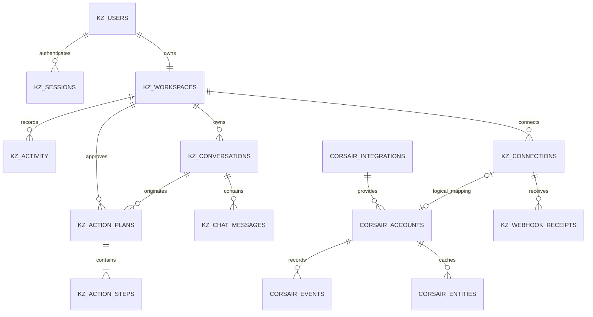

# Database design — PostgreSQL + Drizzle

## Ownership and modeling assumptions
One database. Preserve the official starter's Corsair table definitions/migration ownership; app tables use `kz_` prefix. Reconcile against installed Corsair version before migration. This is a design, not an executable migration. Personal workspace, one account per provider, opaque Google/Corsair IDs stored as text. App identifiers are UUID; timestamps are timestamptz except explicitly date-only event fields (held by provider). Use JSONB only for flexible validated payloads, not ownership or statuses.

## Entity relationship diagram

Logical mapping is not an imposed FK across ownership boundaries. Validate tenant + integration + account on every use. Session table is conditional on selected auth mechanism; do not create duplicate library-owned auth storage.

## Corsair-owned tables (starter observed schema, abbreviated)
| Table | Key columns | Purpose |
|---|---|---|
| corsair_integrations | id, name, config, dek, created_at, updated_at | integration configuration |
| corsair_accounts | id, tenant_id, integration_id, config, dek, created_at, updated_at | tenant connection state |
| corsair_entities | id, account_id, entity_id, entity_type, version, data, created_at, updated_at | cached provider entities |
| corsair_events | id, account_id, event_type, payload, status, created_at, updated_at | integration events |
Do not write encrypted configs or cache rows directly, duplicate provider tokens, or alter Corsair constraints without upstream compatibility review. Cache deduplication may be required by entity ID and newest updated timestamp; IDs are scoped by account and entity type.

## Kriyzen-owned tables (proposed)
Notation: `!` required; otherwise nullable. Every id PK UUID, every created_at ! defaults now; updated_at ! where mutable, maintained by application/ORM. All status values constrained via enum/check. Tables below are logical columns; auth library choice can change only identity/session implementation via ADR.

| Table | Columns and constraints |
|---|---|
| kz_users | id, google_sub text ! unique (stable OIDC subject, not email), email text !, display_name text, avatar_url text, timezone text ! default Asia/Kolkata (user-editable), created_at, updated_at |
| kz_workspaces | id, owner_user_id UUID ! FK users unique, corsair_tenant_id text ! unique (server-generated), name text !, created_at, updated_at |
| kz_sessions (conditional) | id, user_id UUID ! FK users, token_hash text ! unique, expires_at timestamptz !, revoked_at timestamptz, created_at; replace with approved library/session design if applicable |
| kz_connections | id, workspace_id UUID ! FK workspaces, provider text ! (gmail/googlecalendar), corsair_account_id text unique nullable until verified, account_label text, status text !, last_synced_at timestamptz, last_error_code text, created_at, updated_at; unique(workspace_id,provider) |
| kz_conversations | id, workspace_id UUID ! FK workspaces, title text !, created_at, updated_at |
| kz_chat_messages | id, workspace_id UUID !, conversation_id UUID !, role text ! (user/assistant/tool), parts JSONB ! (validated, bounded), created_at; composite FK to conversation workspace/id |
| kz_action_plans | id, workspace_id UUID !, conversation_id UUID !, revision int ! default 1, status text !, payload_hash text !, expires_at timestamptz !, approved_by UUID FK users, approved_at timestamptz, created_at, updated_at; composite FK conversation |
| kz_action_steps | id, workspace_id UUID !, plan_id UUID !, ordinal int !, kind text !, input JSONB !, status text !, idempotency_key text !, provider_reference text, error_code text, attempt_count int ! default 0, started_at timestamptz, finished_at timestamptz, created_at, updated_at; unique(plan_id,ordinal), unique(workspace_id,idempotency_key), composite FK plan |
| kz_activity | id, workspace_id UUID ! FK workspaces, actor_type text !, operation text !, status text !, reference_id text, safe_summary text, created_at |
| kz_webhook_receipts (P1, only if Corsair does not already deduplicate sufficiently) | id, workspace_id UUID !, connection_id UUID !, delivery_key text !, status text !, attempts int ! default 0, created_at, updated_at; unique(connection_id,delivery_key); composite FK connection |

Every composite parent referenced above has unique(workspace_id,id). Non-composite child workspace FK implied for all workspace-owned rows. Validate approved_by is owner server-side, or enforce additional composite relationship. Plan/step input cannot mutate after approval: edit creates a new revision with new hash (same plan may be updated only while proposed; old approval rejected). Hash covers ordered steps, validated inputs, workspace and revision; canonical server serialization. Use explicit version checks in transactions. Cascade dependent app data only through deliberate workspace/account deletion procedures; never cascade into Corsair by guesswork.

## State machines
Connection: disconnected → connecting → connected; errors → needs_reauth/error; disconnect invalidates tools immediately. Plan: proposed → approved → executing → succeeded/partial_failed/failed/needs_reconciliation; proposed → cancelled/expired. Steps: pending → running → succeeded/failed/unknown; downstream → skipped if dependency fails. Reconcile unknown before any replay. A partial plan may resume only independently verified safe failed steps after explicit retry approval; never replay succeeded steps.

## Indexes
- users(google_sub), workspaces(owner_user_id), workspaces(corsair_tenant_id) unique.
- connections(workspace_id,provider) unique; activity(workspace_id,created_at DESC).
- conversations(workspace_id,updated_at DESC); messages(conversation_id,created_at,id).
- plans(workspace_id,status,expires_at); steps(plan_id,ordinal) unique; idempotency uniqueness above.
- Index all frequently joined foreign keys not covered by existing indexes. Inspect Corsair cache query plans before proposing indexes; do not modify vendor tables casually.

## Transaction and retry strategy
Atomically claim plan with status/revision/hash/expiry and owner checks; record each step running before live call, then persist result immediately after. A crash after a remote effect but before local commit is ambiguous; inspect remote state. Event client-generated ID may help if the installed endpoint supports it; Gmail send has no assumed idempotency guarantee. Unknown sends require reconciliation or manual resolution; never automatically retry them. No distributed exactly-once claim.

## Privacy, retention, migrations
Store minimal chat/tool context, not duplicated inbox content. Suggested demo retention: 30 days chat/activity, 7 days webhook receipts if needed; actual retention policy requires owner approval and a deletion procedure. Keep credentials exclusively in approved credential/session storage. Encrypt KEK and secrets operationally; use test accounts. On disconnect, verify revocation and vendor-cache deletion behavior. Migration sequence: inspect starter → choose one authoritative migration history → baseline vendor schema in disposable DB → generate app migrations → review SQL → apply locally → test isolation and clean restore → production migration with backup. Do not use destructive schema push on production. No migration has been executed by this documentation task.
